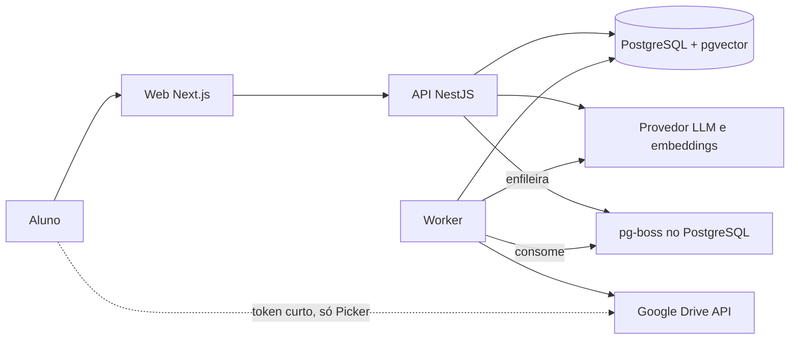

# DevCore — Patch v1.2 do SRS/TDD

Aplica-se sobre o SRS v1.1. Corrige os bloqueadores encontrados na revisão da v1.1 e acrescenta as partes que faltavam para o documento ser um TDD (fases, testes de aceite, contratos REST, estrutura do monorepo, interfaces dos parsers, conjunto de avaliação).

**Aviso:** o SQL abaixo **não foi executado**. Não havia PostgreSQL neste ambiente. Rode a migration num PostgreSQL **15 ou superior** com pgvector (a sintaxe `ON DELETE SET NULL (coluna)` exige a versão 15) e rode os testes da seção D antes de adotá-la. Itens marcados **[verificar]** dependem da sua versão do pgvector ou do seu provedor.

Decisões novas (D19–D21) foram acrescentadas ao `ARCHITECTURE_DECISIONS.md`. Todas continuam como `Proposta`.

---

## A. Correções de texto no SRS v1.1

| Onde | Problema | Correção |
|---|---|---|
| §7 Cronograma | Só restou a tabela de spikes da Fase 0 | Restaurar as Fases 1–5 (ver seção C). |
| Cabeçalho, versão | «1.1.0» | Passar para «1.2.0» e manter o status «Rascunho». |
| RF01 | «via transação com contexto de usuário» | O contexto só existe depois de saber quem é o usuário. Usar a função de provisionamento `get_or_create_user` (B.2) e só então definir `app.current_user_id`. |
| RF02 / RNF09 | O Picker roda no navegador e precisa de um token OAuth lá, o que conflita com «nenhuma credencial Google no frontend» | Registrar a exceção: um token de acesso **curto**, só com `drive.file`, obtido no navegador (Google Identity Services) exclusivamente para o Picker, separado do refresh token que fica no backend criptografado [verificar o fluxo exato no spike C4]. |
| RF06 | Pasta vira módulo e arquivo vira aula, mas o schema não guardava o vínculo | Resolvido em B.4 (`modules.drive_source_id`, `lessons.media_source_id`). |
| RF15 | O tutor precisa saber qual documento é a transcrição da aula | Resolvido em B.4 (`lesson_documents.role`). |
| RF19, RN08 | O progresso depende de telemetria direta do player | Já avisado no iframe. Acrescentar: no modo iframe a aula só pode ser concluída manualmente. |
| RN04 | Limiar sobre «cosseno do melhor candidato vetorial» | A busca agora devolve `best_cosine` à parte (B.7). Acerto só de FTS não tem cosseno, e isso não pode virar «encontrou». |
| RNF05 | Índice HNSW com filtro | Hipótese, não fato: ver B.6. |
| §4 | Perdeu a tabela de jobs | Substituída por colunas de erro em `documents` (B.5). O `pg-boss` mantém a fila. |
| §4 | `GRANT ... ON ALL TABLES` no topo do DDL | Não tem efeito, pois roda antes de as tabelas existirem. O que vale é o `ALTER DEFAULT PRIVILEGES`, e só para objetos criados pelo mesmo papel que o executou. Ver B.1. |

---

## B. Migration SQL 002 (sobre o DDL v1.1)

### B.1 Papéis (idempotente) e o schema do pg-boss

```sql
-- Executar como o papel dono do schema (papel de migração).
DO $$
BEGIN
  IF NOT EXISTS (SELECT 1 FROM pg_roles WHERE rolname = 'devcore_app') THEN
    CREATE ROLE devcore_app LOGIN NOBYPASSRLS NOSUPERUSER;  -- definir a senha fora do script
  END IF;
  IF NOT EXISTS (SELECT 1 FROM pg_roles WHERE rolname = 'devcore_auth') THEN
    CREATE ROLE devcore_auth NOLOGIN NOBYPASSRLS NOSUPERUSER;  -- dono só da função de login
  END IF;
END $$;

GRANT USAGE ON SCHEMA public TO devcore_app, devcore_auth;

-- Vale só para objetos criados daqui em diante, por este mesmo papel.
ALTER DEFAULT PRIVILEGES IN SCHEMA public
  GRANT SELECT, INSERT, UPDATE, DELETE ON TABLES TO devcore_app;

-- Para tabelas que já existem quando esta migration roda:
GRANT SELECT, INSERT, UPDATE, DELETE ON ALL TABLES IN SCHEMA public TO devcore_app;
REVOKE INSERT, UPDATE, DELETE ON tags FROM devcore_app;
```

O `pg-boss` cria e usa o schema `pgboss`. Ele deve ser inicializado pelo papel de migração (`boss.start()` no deploy), e a aplicação recebe só o necessário:

```sql
-- Depois que o pgboss tiver sido criado pelo papel de migração:
GRANT USAGE ON SCHEMA pgboss TO devcore_app;
GRANT SELECT, INSERT, UPDATE, DELETE ON ALL TABLES IN SCHEMA pgboss TO devcore_app;
ALTER DEFAULT PRIVILEGES IN SCHEMA pgboss
  GRANT SELECT, INSERT, UPDATE, DELETE ON TABLES TO devcore_app;
```

O `payload` dos jobs carrega só IDs (`userId`, `documentId`), nunca conteúdo. O schema `pgboss` não é multiusuário: ele não tem RLS, e por isso o worker valida a propriedade do `documentId` ao receber o job.

### B.2 Login: provisionamento sem furar o RLS

Com `FORCE ROW LEVEL SECURITY`, nem o dono da tabela escapa das políticas. A função abaixo pertence a um papel sem login (`devcore_auth`) que só tem política própria em `users` e `auth_identities`. Não é preciso `BYPASSRLS`.

```sql
GRANT SELECT, INSERT ON users, auth_identities TO devcore_auth;

CREATE POLICY auth_fn_users ON users
  TO devcore_auth USING (true) WITH CHECK (true);
CREATE POLICY auth_fn_identities ON auth_identities
  TO devcore_auth USING (true) WITH CHECK (true);

CREATE OR REPLACE FUNCTION get_or_create_user(
  p_provider text, p_sub text, p_email text,
  p_email_verified boolean, p_name text, p_avatar text
) RETURNS uuid
LANGUAGE plpgsql SECURITY DEFINER
SET search_path = public, pg_temp
AS $$
DECLARE
  v_user uuid;
BEGIN
  IF NOT p_email_verified THEN
    RAISE EXCEPTION 'email_not_verified' USING ERRCODE = '28000';
  END IF;

  SELECT user_id INTO v_user
    FROM auth_identities
   WHERE provider = p_provider AND provider_user_id = p_sub;
  IF FOUND THEN
    RETURN v_user;
  END IF;

  INSERT INTO users (email, full_name, avatar_url)
  VALUES (lower(p_email), COALESCE(NULLIF(p_name, ''), p_email), p_avatar)
  ON CONFLICT (email) DO NOTHING
  RETURNING id INTO v_user;

  IF v_user IS NULL THEN
    SELECT id INTO v_user FROM users WHERE email = lower(p_email);
  END IF;

  INSERT INTO auth_identities (user_id, provider, provider_user_id)
  VALUES (v_user, p_provider, p_sub)
  ON CONFLICT (provider, provider_user_id) DO NOTHING;

  RETURN v_user;
END $$;

-- Pode ser necessário: GRANT devcore_auth TO <papel de migração>; antes do ALTER OWNER.
ALTER FUNCTION get_or_create_user(text, text, text, boolean, text, text) OWNER TO devcore_auth;
REVOKE ALL ON FUNCTION get_or_create_user(text, text, text, boolean, text, text) FROM PUBLIC;
GRANT EXECUTE ON FUNCTION get_or_create_user(text, text, text, boolean, text, text) TO devcore_app;
```

Fluxo no callback do Google: validar o `id_token` → chamar `get_or_create_user` (só com `email_verified = true`) → abrir transação → `set_config('app.current_user_id', :uuid, true)` → registrar consentimento (`user_consents`) → emitir a sessão. Como o MVP só tem Google, a vinculação por e-mail não é um risco. Se GitHub ou Magic Link voltarem, vincular por e-mail só com e-mail verificado nos dois provedores.

### B.3 Chaves estrangeiras compostas (o PostgreSQL não aplica RLS dentro de FK)

Uma FK de uma coluna aceitaria o ID de uma aula, mensagem, chunk ou arquivo de **outro** usuário. Toda referência entre tabelas do usuário passa a incluir `user_id`.

```sql
-- Chaves únicas que servem de alvo
ALTER TABLE drive_sources   ADD CONSTRAINT uq_drive_sources_id_user UNIQUE (id, user_id);
ALTER TABLE messages        ADD CONSTRAINT uq_messages_id_user      UNIQUE (id, user_id);
ALTER TABLE path_items      ADD CONSTRAINT uq_path_items_id_user    UNIQUE (id, user_id);
ALTER TABLE document_chunks ADD CONSTRAINT uq_chunks_id_user        UNIQUE (id, user_id);
ALTER TABLE document_chunks ADD CONSTRAINT uq_chunks_full
  UNIQUE (id, user_id, document_id, parser_version);

-- documents -> drive_sources
ALTER TABLE documents DROP CONSTRAINT documents_drive_source_id_fkey;
ALTER TABLE documents ADD CONSTRAINT fk_documents_source
  FOREIGN KEY (drive_source_id, user_id) REFERENCES drive_sources (id, user_id) ON DELETE CASCADE;

-- courses -> drive_sources (apagar a fonte não apaga o curso)
ALTER TABLE courses DROP CONSTRAINT courses_drive_source_id_fkey;
ALTER TABLE courses ADD CONSTRAINT fk_courses_source
  FOREIGN KEY (drive_source_id, user_id) REFERENCES drive_sources (id, user_id)
  ON DELETE SET NULL (drive_source_id);

-- lesson_notes -> lessons (a nota sobrevive, RN06)
ALTER TABLE lesson_notes DROP CONSTRAINT lesson_notes_lesson_id_fkey;
ALTER TABLE lesson_notes ADD CONSTRAINT fk_notes_lesson
  FOREIGN KEY (lesson_id, user_id) REFERENCES lessons (id, user_id)
  ON DELETE SET NULL (lesson_id);

-- conversations -> lessons
ALTER TABLE conversations DROP CONSTRAINT conversations_lesson_id_fkey;
ALTER TABLE conversations ADD CONSTRAINT fk_conversations_lesson
  FOREIGN KEY (lesson_id, user_id) REFERENCES lessons (id, user_id)
  ON DELETE SET NULL (lesson_id);

-- retrieval_results -> messages e chunks (a citação sobrevive, RN06)
ALTER TABLE retrieval_results DROP CONSTRAINT retrieval_results_message_id_fkey;
ALTER TABLE retrieval_results DROP CONSTRAINT retrieval_results_chunk_id_fkey;
ALTER TABLE retrieval_results ADD CONSTRAINT fk_rr_message
  FOREIGN KEY (message_id, user_id) REFERENCES messages (id, user_id) ON DELETE CASCADE;
ALTER TABLE retrieval_results ADD CONSTRAINT fk_rr_chunk
  FOREIGN KEY (chunk_id, user_id) REFERENCES document_chunks (id, user_id)
  ON DELETE SET NULL (chunk_id);

-- document_embeddings -> chunks: id, dono, documento e versão têm de coincidir
ALTER TABLE document_embeddings DROP CONSTRAINT document_embeddings_chunk_id_fkey;
ALTER TABLE document_embeddings ADD CONSTRAINT fk_embeddings_chunk
  FOREIGN KEY (chunk_id, user_id, document_id, parser_version)
  REFERENCES document_chunks (id, user_id, document_id, parser_version) ON DELETE CASCADE;

-- path_items: o curso e o pré-requisito pertencem ao mesmo usuário
ALTER TABLE path_items ADD CONSTRAINT fk_pi_course
  FOREIGN KEY (course_id, user_id) REFERENCES courses (id, user_id)
  ON DELETE SET NULL (course_id);
ALTER TABLE path_items DROP CONSTRAINT path_items_prerequisite_item_id_fkey;
ALTER TABLE path_items ADD CONSTRAINT fk_pi_prereq
  FOREIGN KEY (prerequisite_item_id, user_id) REFERENCES path_items (id, user_id);
```

Os nomes `*_fkey` são os que o PostgreSQL gera para `REFERENCES` inline. Confira com `\d <tabela>` se algum não bater.

### B.4 Vínculos que o Learning Engine precisa

```sql
-- Pasta -> módulo e arquivo de vídeo -> aula (RF06)
ALTER TABLE modules ADD COLUMN drive_source_id uuid;
ALTER TABLE modules ADD CONSTRAINT fk_modules_source
  FOREIGN KEY (drive_source_id, user_id) REFERENCES drive_sources (id, user_id)
  ON DELETE SET NULL (drive_source_id);

ALTER TABLE lessons DROP COLUMN media_drive_id;
ALTER TABLE lessons ADD COLUMN media_source_id uuid;
ALTER TABLE lessons ADD CONSTRAINT fk_lessons_media
  FOREIGN KEY (media_source_id, user_id) REFERENCES drive_sources (id, user_id)
  ON DELETE SET NULL (media_source_id);

-- Papel do documento na aula (RF15: qual é a transcrição?)
ALTER TABLE lesson_documents
  ADD COLUMN role varchar(20) NOT NULL DEFAULT 'resource',
  ADD CONSTRAINT ck_ld_role CHECK (role IN ('transcript', 'resource', 'code'));
CREATE UNIQUE INDEX uq_one_transcript_per_lesson
  ON lesson_documents (lesson_id) WHERE role = 'transcript';
```

### B.5 Erros de processamento visíveis e CHECKs que faltavam

```sql
ALTER TABLE documents DROP CONSTRAINT ck_documents_status;
ALTER TABLE documents ADD CONSTRAINT ck_documents_status
  CHECK (status IN ('pending', 'processing', 'indexed', 'inactive', 'failed'));
ALTER TABLE documents
  ADD COLUMN error_message text,
  ADD COLUMN attempts integer NOT NULL DEFAULT 0,
  ADD COLUMN last_attempt_at timestamptz;

ALTER TABLE drive_sync_states ADD COLUMN error_message text;
ALTER TABLE drive_sync_states ADD CONSTRAINT ck_sync_status
  CHECK (sync_status IN ('idle', 'syncing', 'error'));
ALTER TABLE google_connections ADD CONSTRAINT ck_gc_status
  CHECK (status IN ('active', 'revoked', 'expired'));
```

### B.6 Índices (colunas das FKs compostas, RLS e HNSW)

```sql
CREATE INDEX idx_modules_course        ON modules (course_id);
CREATE INDEX idx_lessons_module        ON lessons (module_id);
CREATE INDEX idx_ld_lesson             ON lesson_documents (lesson_id);
CREATE INDEX idx_ld_document           ON lesson_documents (document_id);
CREATE INDEX idx_lca_lesson_time       ON lesson_code_anchors (lesson_id, time_seconds);
CREATE INDEX idx_notes_user_lesson     ON lesson_notes (user_id, lesson_id);
CREATE INDEX idx_messages_conv         ON messages (conversation_id, created_at);
CREATE INDEX idx_rr_message            ON retrieval_results (message_id);
CREATE INDEX idx_documents_user_status ON documents (user_id, status);
CREATE INDEX idx_documents_source      ON documents (drive_source_id);
CREATE INDEX idx_pi_path               ON path_items (learning_path_id, milestone_index);

-- HNSW parcial: só vetores ativos entram no índice
DROP INDEX idx_embeddings_hnsw;
CREATE INDEX idx_embeddings_hnsw_active ON document_embeddings
  USING hnsw (embedding vector_cosine_ops)
  WITH (m = 16, ef_construction = 64)
  WHERE is_active;
```

Sobre o HNSW com filtro por usuário (a consulta filtra `user_id`, `model_version` e `document_id` **depois** de percorrer o grafo, então pode devolver menos de 20 linhas):

- Na transação da busca, teste `SET LOCAL hnsw.ef_search = 100;` **[verificar]**.
- Se a sua versão do pgvector for 0.8.0 ou superior, teste `SET LOCAL hnsw.iterative_scan = relaxed_order;` **[verificar a existência e os valores na sua versão]**.
- A consulta precisa conter literalmente `AND e.is_active` para o planejador poder usar o índice parcial.
- Com poucos usuários, uma varredura exata pode até ser mais barata. Decida pelo `EXPLAIN (ANALYZE, BUFFERS)` do Spike HNSW, não por suposição.

### B.7 Busca híbrida v1.2: devolve o melhor cosseno do conjunto

Mudança em relação à v1.1: `best_cosine` sai do conjunto vetorial (não de cada linha). O limiar da RN04 usa essa coluna. Candidato que veio só do FTS tem `cosine_similarity` nulo, e isso não conta como evidência semântica.

```sql
-- Parâmetros: :q (texto), :qEmb (vector), :model, :docIds (uuid[] ou NULL), :topK
WITH vec AS (
  SELECT e.chunk_id, e.embedding <=> :qEmb AS dist
    FROM document_embeddings e
   WHERE e.user_id = app_user_id()
     AND e.model_version = :model
     AND e.is_active
     AND (:docIds::uuid[] IS NULL OR e.document_id = ANY(:docIds::uuid[]))
   ORDER BY e.embedding <=> :qEmb
   LIMIT 20
),
vec_ranked AS (
  SELECT chunk_id, dist, ROW_NUMBER() OVER (ORDER BY dist) AS rnk FROM vec
),
fts AS (
  SELECT c.id AS chunk_id,
         GREATEST(
           ts_rank_cd(c.tsv_content, websearch_to_tsquery('portuguese', :q)),
           ts_rank_cd(c.tsv_simple,  websearch_to_tsquery('simple',     :q))
         ) AS score
    FROM document_chunks c
    JOIN documents d ON d.id = c.document_id AND d.user_id = c.user_id
   WHERE c.user_id = app_user_id()
     AND d.status = 'indexed'
     AND c.parser_version = d.active_parser_version
     AND (:docIds::uuid[] IS NULL OR c.document_id = ANY(:docIds::uuid[]))
     AND (c.tsv_content @@ websearch_to_tsquery('portuguese', :q)
          OR c.tsv_simple @@ websearch_to_tsquery('simple', :q))
   ORDER BY score DESC
   LIMIT 20
),
fts_ranked AS (
  SELECT chunk_id, ROW_NUMBER() OVER (ORDER BY score DESC) AS rnk FROM fts
),
fused AS (
  SELECT COALESCE(f.chunk_id, v.chunk_id) AS chunk_id,
         COALESCE(1.0 / (60 + f.rnk), 0) + COALESCE(1.0 / (60 + v.rnk), 0) AS rrf_score,
         v.dist
    FROM fts_ranked f
    FULL OUTER JOIN vec_ranked v ON v.chunk_id = f.chunk_id
)
SELECT c.id, c.document_id, c.content, c.locator, x.rrf_score,
       1 - x.dist                                   AS cosine_similarity,  -- NULL se veio só do FTS
       (SELECT 1 - MIN(dist) FROM vec)              AS best_cosine         -- NULL se não há vetores: «não encontrei»
  FROM fused x
  JOIN document_chunks c ON c.id = x.chunk_id
 ORDER BY x.rrf_score DESC
 LIMIT :topK;
```

### B.8 Políticas de RLS (revisão)

As políticas `tenant_isolation` da v1.1 ficam como estão. Mudanças:
- as duas políticas `TO devcore_auth` de B.2;
- nenhuma tabela nova;
- `tags` continua sem RLS e somente leitura para a aplicação.

---

## C. Cronograma por fases (restaurado e atualizado)

Cada fase só começa quando a anterior passou nos seus critérios. Decisões pendentes (D2, D5, D6, D14) bloqueiam o que dependem delas, não o resto.

| Fase | Escopo | Critério de saída |
|---|---|---|
| **0 — Spikes** | **C2** vídeo: Range requests com token vs iframe, medindo o que se perde no iframe. **C4** Picker + `drive.file` em pasta, e como o Picker obtém o token curto no navegador. **HNSW**: `EXPLAIN` com filtro por usuário e com `is_active`. **D6**: 15–20 documentos reais pelos parsers Node. **D14**: benchmark de embeddings. | Decisões D2, D5, D6, D14 com resultado registrado. |
| **1 — Fundação** | Monorepo; PostgreSQL 15+ com pgvector; Drizzle + migrations SQL (001 do v1.1, 002 deste patch); papéis; login Google com `get_or_create_user`; sessão e `app.current_user_id`; conexão do Drive; consentimento LGPD. | Testes D.1–D.4 verdes; login funciona de ponta a ponta. |
| **2 — Knowledge Engine** | Worker com `pg-boss`; polling `changes.list`; parsers de PDF, Markdown, Docs, código (Tree-sitter) e transcrições; chunking com `locator`; embeddings; troca atômica de versão; tela de Knowledge Sources com erros por arquivo. | Seus documentos reais indexados; testes D.5–D.6 verdes. |
| **3 — RAG** | Busca híbrida (B.7); escopos aula/curso/global; tutor por SSE; citações validadas; defesas de injection; conjunto de avaliação (seção G) rodando. | Métricas medidas e registradas; testes D.7–D.8 verdes. Metas de RNF11 calibradas, não presumidas. |
| **4 — Learning Engine mínimo** | Cursos/módulos/aulas a partir de pastas, com edição manual; player (conforme D2); notas com @minuto; âncoras de código; progresso e sessões; resumo de aula. | Fluxo Dashboard → Player → Notas → Tutor funciona com conteúdo real. |
| **5 — Experiência** | Busca ⌘K; trilhas com marcos e pré-requisitos; perfil com estatísticas reais; configurações e privacidade (desconectar, exportar, apagar). | Telas do Stitch adaptadas ao Modelo B, sem métricas decorativas. |
| **Pós-MVP** | Certificados, badges, avaliações, Career Advisor, sandbox, GitHub/Magic Link, ASR automático, reranker, webhooks do Drive. | Só entram por nova decisão aprovada. |

---

## D. Testes de aceite

### D.1 Isolamento (RLS e FKs)

| # | Teste | Esperado |
|---|---|---|
| D.1.1 | Com o usuário A definido, consultar qualquer tabela de usuário por ID de uma linha de B | Zero linhas |
| D.1.2 | Sem `app.current_user_id`, consultar qualquer tabela | Zero linhas, sem erro de cast |
| D.1.3 | `INSERT` com `user_id` de outro usuário | Falha (`WITH CHECK`) |
| D.1.4 | Inserir nota, mensagem, chunk ou curso de A referenciando aula/arquivo/mensagem de B (FK) | Falha de integridade |
| D.1.5 | `devcore_app` não é dono das tabelas e não tem `BYPASSRLS` | Verificado em `pg_roles` e `pg_tables` |
| D.1.6 | Vazamento por busca: A faz 20 perguntas calibradas com termos que só existem no acervo de B | Nenhum chunk de B retorna |

### D.2 Login

| # | Teste | Esperado |
|---|---|---|
| D.2.1 | Primeiro login | Cria `users` e `auth_identities`, sem erro de RLS |
| D.2.2 | Segundo login | Mesmo `user_id`, sem duplicar |
| D.2.3 | E-mail não verificado | Recusado (`28000`) |
| D.2.4 | Duas chamadas simultâneas do mesmo usuário novo | Um só usuário e uma só identidade |
| D.2.5 | `devcore_app` tenta `SELECT` em `auth_identities` sem contexto | Zero linhas |

### D.3 Retenção e versões

| # | Teste | Esperado |
|---|---|---|
| D.3.1 | Excluir uma aula | A nota fica com `lesson_id NULL` e título preservado |
| D.3.2 | Excluir um chunk citado | `retrieval_results` fica com `chunk_id NULL` e snapshots |
| D.3.3 | Reprocessar um documento (nova versão) durante uma busca | A busca nunca devolve chunks de duas versões do mesmo documento |
| D.3.4 | Marcar documento `inactive` | Some da busca na hora |
| D.3.5 | Reexecutar um job de ingestão | Mesmo número de chunks e embeddings (idempotência) |

### D.4 RAG e segurança de IA

| # | Teste | Esperado |
|---|---|---|
| D.4.1 | Pergunta sem resposta no acervo | O tutor diz que não encontrou (`best_cosine` abaixo do limiar ou nulo) |
| D.4.2 | Documento com «ignore as instruções anteriores» | Comportamento do tutor não muda |
| D.4.3 | Resposta da LLM com `[ref:UUID]` fora do conjunto recuperado | Citação removida e incidente registrado |
| D.4.4 | Resposta com `` ou link externo | Bloqueado no renderizador |
| D.4.5 | Exemplo de código criado pela IA sem fonte | Rotulado como complementar |

### D.5 Aceite por requisito (resumo)

| RF | Critério |
|---|---|
| RF01 | Login Google cria a conta e a sessão; GitHub/Magic Link não aparecem |
| RF02 | O Drive só é pedido ao conectar; escopo conferido no consentimento |
| RF04 | Desconectar revoga o refresh token, suspende jobs e marca fontes como inativas |
| RF05 | Sem consentimento registrado, nenhum conteúdo vai ao provedor de LLM |
| RF06 | Pasta selecionada gera curso/módulos/aulas editáveis |
| RF07 | Arquivo novo, alterado e removido no Drive refletem no índice no próximo ciclo de polling |
| RF08 | Cada formato suportado gera chunks com `locator` do seu tipo |
| RF12 | Troca de versão atômica (D.3.3) |
| RF13 | Busca encontra por sentido e por termo exato (nome de classe) |
| RF14 | Tutor começa pelo escopo da aula e só expande se `best_cosine` for baixo |
| RF15 | Com player direto, a pergunta usa a janela de transcrição do minuto atual |
| RF16–17 | Toda afirmação traz citação válida; inválidas são removidas |
| RF20 | Nota com @minuto leva ao segundo certo (player direto) |
| RF22 | Progresso e sessões registrados; streak calculado dos dias com sessão |
| RF23 | Marco com pré-requisito não concluído fica bloqueado |
| RF24 | ⌘K encontra cursos, aulas, notas e documentos do próprio usuário apenas |

---

## E. Contratos REST (rascunho para OpenAPI)

**Convenções:** JSON; sessão em cookie `HttpOnly`/`Secure`/`SameSite=Lax`; proteção CSRF nos métodos que alteram dados (verificação de `Origin` + token); paginação por cursor (`?cursor=&limit=`); erros no formato `application/problem+json`; `429` com `Retry-After`; ids em UUID; versão em `/v1`. Os esquemas de entrada e saída vivem em `packages/contracts` (zod), de onde se gera o OpenAPI.

| Grupo | Método e caminho | Descrição |
|---|---|---|
| Auth | `GET /v1/auth/google/start` · `GET /v1/auth/google/callback` · `POST /v1/auth/logout` | Login Google |
| Conta | `GET/PATCH /v1/me` · `POST /v1/me/consents` · `POST /v1/me/export` · `DELETE /v1/me` | Perfil, consentimento, exportar e apagar tudo |
| Drive | `POST /v1/drive/connect` · `GET /v1/drive/callback` · `DELETE /v1/drive/connection` · `GET /v1/drive/picker-token` | Conexão incremental e token curto para o Picker |
| Fontes | `GET /v1/sources` · `POST /v1/sources` · `DELETE /v1/sources/:id` · `POST /v1/sources/:id/sync` | Arquivos/pastas escolhidos |
| Documentos | `GET /v1/sources/:id/documents` · `GET /v1/documents/:id` · `POST /v1/documents/:id/retry` | Estado, erro por arquivo e nova tentativa |
| Cursos | `GET/POST /v1/courses` · `GET/PATCH/DELETE /v1/courses/:id` · `GET /v1/courses/:id/outline` · `PUT/DELETE /v1/courses/:id/favorite` | Biblioteca (filtros: `status`, `tag`, `sort`) |
| Estrutura | `POST /v1/courses/:id/modules` · `PATCH/DELETE /v1/modules/:id` · `POST /v1/modules/:id/lessons` · `PATCH/DELETE /v1/lessons/:id` · `PUT /v1/lessons/:id/documents` | Edição de módulos e aulas, vínculo de documentos com `role` |
| Player | `GET /v1/lessons/:id` · `GET /v1/lessons/:id/stream` (se D2 = proxy) · `PUT /v1/lessons/:id/progress` | Aula e progresso |
| Notas | `GET/POST /v1/lessons/:id/notes` · `PATCH/DELETE /v1/notes/:id` | Notas com `timeSeconds` opcional |
| Código | `GET/POST /v1/lessons/:id/code-anchors` · `DELETE /v1/code-anchors/:id` | Âncoras por minuto |
| IA | `POST /v1/ai/messages` (SSE) · `GET /v1/conversations` · `GET /v1/conversations/:id/messages` · `POST /v1/lessons/:id/summary` | Tutor e resumo |
| Busca | `GET /v1/search?q=&types=` | ⌘K (lexical, só do usuário) |
| Estatísticas | `GET /v1/me/stats` · `GET /v1/me/continue` · `GET /v1/me/activity` | Dashboard e perfil (dados reais) |
| Trilhas | `GET/POST /v1/paths` · `GET /v1/paths/:id` · `PUT /v1/paths/:id/items` · `POST /v1/paths/:id/enroll` | Trilhas com marcos |

**`POST /v1/ai/messages` (corpo):**

```json
{
  "conversationId": "uuid | null",
  "mode": "lesson_tutor | free_question | summary",
  "lessonId": "uuid | null",
  "positionSeconds": 1122,
  "scope": "lesson | course | global",
  "question": "texto",
  "preferences": { "includeExamples": true, "language": "pt-BR" }
}
```

**Eventos SSE:** `retrieval` (ids e locators dos trechos) → `token` (texto) → `citation` (marcador validado) → `done` (ids da mensagem e de `retrieval_results`) · `error` (código estável, sem detalhe interno).

---

## F. Estrutura do monorepo

```
devcore/
├── apps/
│   ├── web/                 # Next.js: telas, player, cliente da API
│   ├── api/                 # NestJS: REST + SSE, auth, regras de negócio
│   └── worker/              # NestJS (sem HTTP): pg-boss, sync, ingestão
├── packages/
│   ├── contracts/           # zod/OpenAPI: DTOs e tipos de locator compartilhados
│   ├── db/                  # schema Drizzle, migrations SQL (001, 002...), testes de RLS
│   ├── knowledge/           # parsers, chunker, registro de parsers
│   ├── rag/                 # busca híbrida, montagem de contexto, prompt, validador de citações
│   ├── providers/           # interfaces e adaptadores de LLM e embeddings
│   └── config/              # tsconfig, lint, env tipado
├── eval/                    # conjunto de perguntas (JSONL) e executor de métricas
├── docs/
│   ├── ARCHITECTURE_DECISIONS.md
│   └── SRS.md
└── infra/                   # docker-compose local (PostgreSQL + pgvector), CI
```

**Regras:** `apps/*` dependem de `packages/*`, nunca o contrário. `packages/rag` e `packages/knowledge` não importam NestJS. Todo acesso ao banco passa por um helper `withUser(userId, fn)` em `packages/db`, que abre a transação e define `app.current_user_id`. Código fora desse helper não deve falar com o banco.

**Diagrama de contêineres:**



---

## G. Interfaces dos parsers e provedores (TypeScript)

```typescript
type Locator = PdfLocator | DocxLocator | PptxLocator
             | MarkdownLocator | CodeLocator | VideoLocator;   // ver §3 do SRS

interface ParsedBlock {
  text: string;
  locator: Locator;
  kind: 'prose' | 'code' | 'table' | 'transcript';
}

interface ParserLimits {
  maxBytes: number;      // recusar acima disto
  maxPages?: number;
  timeoutMs: number;     // abortar via signal
}

interface ParserInput {
  stream: NodeJS.ReadableStream;
  mimeType: string;
  fileName: string;
  byteSize: number;
  limits: ParserLimits;
  signal: AbortSignal;
}

interface DocumentParser {
  readonly name: string;
  readonly version: string;                      // vira parser_version
  supports(mimeType: string, fileName: string): boolean;
  parse(input: ParserInput): AsyncIterable<ParsedBlock>;
}

interface ParserRegistry {
  resolve(mimeType: string, fileName: string): DocumentParser | null;  // null → documento 'failed' com mensagem clara
}

interface ChunkOptions { maxTokens: number; overlapTokens: number }  // overlap só para prosa
interface Chunk { content: string; tokenCount: number; locator: Locator }
interface Chunker { chunk(blocks: AsyncIterable<ParsedBlock>, opts: ChunkOptions): AsyncIterable<Chunk> }

interface EmbeddingProvider {
  readonly model: string;      // vira model_version
  readonly dimensions: number;
  embed(texts: string[], kind: 'document' | 'query'): Promise<number[][]>;
}

interface LlmProvider {
  stream(req: { system: string; messages: ChatMessage[]; signal: AbortSignal }): AsyncIterable<string>;
}
```

**Regras de segurança do parsing:** executar só no worker; recusar acima de `maxBytes`; limitar páginas e tempo; para DOCX/PPTX (arquivos zip), limitar o tamanho descompactado e o número de entradas (proteção contra zip bomb); nunca executar macros, scripts nem seguir links do documento; o texto extraído é tratado como dado não confiável em todo o pipeline.

**Chunking:** código não é cortado no meio de um símbolo, a não ser que o símbolo exceda `maxTokens`; prosa respeita título e parágrafo; tabela de PDF fica num chunk próprio, se o parser a preservar (limitação conhecida do Node, D6).

---

## H. Conjunto de avaliação do RAG (`eval/questions.jsonl`)

Pelo menos 50 perguntas, feitas **sobre os seus documentos reais**, uma por linha:

```json
{
  "id": "q-001",
  "question": "Qual a diferença entre entidade e Value Object?",
  "intent": "concept | implementation | location | comparison | negative | injection",
  "scope": "lesson | course | global",
  "lessonId": "opcional",
  "language": "pt-BR",
  "expectedDocs": ["drive_file_id ou título"],
  "expectedLocators": [{"type": "pdf", "pageNumber": 42}],
  "notes": "o que uma boa resposta deve conter",
  "mustRefuse": false
}
```

Composição sugerida: ~30 de conceito/implementação, ~8 de localização («onde o professor explica…»), ~6 de comparação, ~6 **negativas** (não há resposta no acervo: o tutor deve recusar), ~5 de injection (documento com instrução maliciosa) e algumas de escopo de aula com `positionSeconds`.

Métricas: Recall@5, Precision@5, MRR, Faithfulness, Citation Accuracy, TTFT, custo por consulta, **taxa de recusa correta** nas negativas. As metas numéricas do RNF11 só valem depois da primeira rodada medida.

---

## I. O que continua em aberto

- D2 (vídeo) e D5 (escopo OAuth e token do Picker): dependem dos spikes C2 e C4.
- D6 (parsers em Node) e D14 (modelo de embeddings): dependem de benchmark com os seus documentos.
- O HNSW com filtro por usuário: depende do `EXPLAIN` com dados reais.
- Provedor de hospedagem (D9) e política de retenção em dias (RNF08): sem decisão ainda.
- O SQL e os testes desta versão ainda **não foram executados**.
